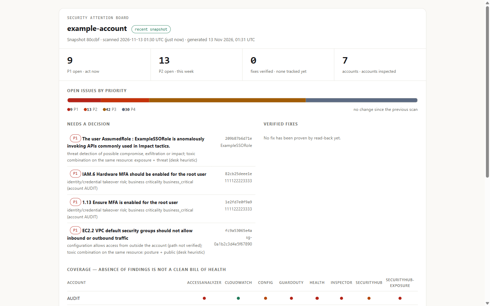

# RemediGenius Community Edition

Your AWS security services already find the problems. RemediGenius pulls their findings into one
desk on the [Hermes agent](https://github.com/NousResearch/hermes-agent), ranks what matters, shows
the evidence behind each issue, and drafts fixes for you to review. It reads your account. It never
changes it.

This package is the desk engine: the `rgtriage` CLI and Python package. The full desk — Hermes
profile, skills and dashboard tabs — installs from the
[repository](https://github.com/RajaRenga/RemediGenius-CE). You bring the AWS account and the model
provider.



## Install

```bash
pip install remedigenius-community
```

Then pick a path in the [quickstart](https://github.com/RajaRenga/RemediGenius-CE/blob/main/docs/QUICKSTART.md):
a Docker workstation on your laptop, an existing Hermes 0.23.1 install, or your own AWS account.
The first step in every path is connecting scoped, read-only AWS access.

## What the desk does

- Reads Security Hub, GuardDuty, Inspector, IAM Access Analyzer, AWS Config, CloudWatch alarms and
  AWS Health. It adds no scanners of its own.
- Builds a P1–P4 queue of grouped issues with written scoring reasons, and a coverage report that
  shows what was read, denied, disabled or unavailable.
- Investigates with bounded read-only calls, separates reported activity from configuration risk,
  and says when a cause is unverified.
- Drafts IaC fixes when matching code exists. A person reviews and ships every change.
- Keeps durable evidence in S3 + Iceberg on AWS, or a local folder on the workstation.

## What it is not

No detectors of its own, AWS only, fixes are proposals, and it is early software that changes
often. Selected findings and chat go to the model provider you configure.
[Known limits](https://github.com/RajaRenga/RemediGenius-CE/blob/main/docs/LIMITS.md) ·
[what leaves your environment](https://github.com/RajaRenga/RemediGenius-CE/blob/main/docs/DATA-FLOW.md)

## Links

- [Homepage](https://www.remedigenius.com)
- [Repository and full README](https://github.com/RajaRenga/RemediGenius-CE)
- [Quickstart](https://github.com/RajaRenga/RemediGenius-CE/blob/main/docs/QUICKSTART.md)
- [Prompt pack](https://github.com/RajaRenga/RemediGenius-CE/blob/main/docs/PROMPTS.md)
- [Issues and discussions](https://github.com/RajaRenga/RemediGenius-CE/issues)
- [Changelog](https://github.com/RajaRenga/RemediGenius-CE/blob/main/CHANGELOG.md)
- [Release validation](https://github.com/RajaRenga/RemediGenius-CE/releases/download/v0.9.2/VALIDATION.md)

Apache-2.0, provided as-is.
