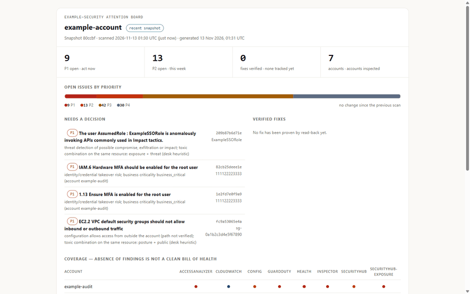
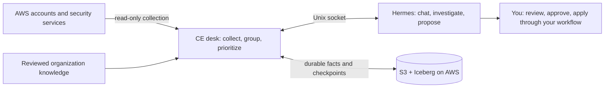

# RemediGenius Community Edition

**Turn AWS security findings into a prioritized queue, evidence-backed investigations, and fixes you can review.**

**Tested with Hermes 0.23.1**

Your AWS services detect the problems. RemediGenius CE brings their findings into one security desk on
[Hermes](https://github.com/NousResearch/hermes-agent): see what needs attention, understand the evidence,
check what was missed, and prepare a fix for human review.

**[Get started](START-HERE.md)** · **[Prompt pack](docs/PROMPTS.md)** · **[Download v0.9.1](https://github.com/RajaRenga/RemediGenius-CE/releases/tag/v0.9.1)**

## The desk at a glance

*The real v0.9.1 dashboard on a live AWS account — a prioritized queue, written scoring reasons, and the
coverage line that says what was and was not read. Account ids, ARNs and bucket names are redacted.*

## See the triage board

*The v0.9.1 desk on a live AWS account (Hermes 0.23.1): a prioritized queue, the reasoning behind each
score, and the coverage matrix that shows what was and was not read. Identifiers are redacted. You drive
it by asking in chat — the [prompt pack](docs/PROMPTS.md) has starting points.*
[More stills and the coverage report](docs/TUTORIAL.md) ·
[v0.9.1 fresh-Spot validation](https://github.com/RajaRenga/RemediGenius-CE/releases/download/v0.9.1/VALIDATION.md)

## What you can do

| Start with | What the desk gives you |
| --- | --- |
| **“What needs my attention?”** | A P1–P4 queue of grouped issues, with written scoring reasons and the scan timestamp. |
| **“Why is this issue P1? Show the evidence.”** | Finding details and bounded read-only investigation, distinguishing reported activity from configuration risk. |
| **`/triage coverage`** | The complete deterministic account/region/source report. Denied, disabled, partial and unavailable scopes stay visible. |
| **“Propose a fix for this issue. Check for matching IaC first.”** | A reviewed procedure or a proposed IaC change when matching code is available. Verification stays pending until supported by evidence. |
| **“Open a task for me to review.”** | A human-owned Kanban card with investigation, fix and verification context. With GitHub configured and explicit authorization, CE can open a fix PR; it cannot approve or merge it. |
| **“Use our ownership and business-criticality rules.”** | Reviewed organization knowledge informs priorities with citations. Explore and maintain it in the Knowledge tab. |

These are example requests, not scripted answers — the [prompt pack](docs/PROMPTS.md) has more to copy and adapt.
**For exact coverage, use `/triage coverage`.** An ordinary briefing may summarize the board's gap preview. A quiet
board, an expired session or a disappearing finding is not proof that an account is safe or a threat is contained.
[Response contract](docs/RESPONSE-CONTRACT.md)

## Start with your environment

| Path | What you need | Start here |
| --- | --- | --- |
| **Existing Hermes 0.23.1** | Your existing model configuration; CE adds a dedicated `remedigenius` profile | [Add CE to Hermes](docs/LOCAL-HERMES.md) |
| **Docker workstation** | Docker and a model provider; use the pinned runtime alongside your current tools | [Run locally](docs/WORKSTATION.md) |
| **AWS Spot** | Your AWS account, reviewed IAM setup, and a model provider | [Deploy in AWS](deploy/aws-single/README.md) |

Then follow one flow:

1. **Connect read-only AWS access.** Use the [access quickstart](docs/ACCESS-QUICKSTART.md) to prepare scoped roles
   for your own account layout. It covers single accounts, Organizations, cross-account readers and delegated service administrators.
2. **Review the discovered scope.** CE distinguishes readable accounts from findings-only access and unavailable
   readers. Choose your regions and inspect the coverage gaps; discovery does not grant permissions.
3. **Run the first scan and ask what needs attention.** Investigate from the queue, review proposed fixes,
   and verify the outcome through your own change process.

AWS collection reads Security Hub (including exposure findings), GuardDuty, Inspector, IAM Access Analyzer,
AWS Config, CloudWatch alarms and AWS Health. Available results depend on which services, regions and permissions
you have enabled. [Multi-account guide](docs/MULTI-ACCOUNT.md) · [Permission flow](docs/PERMISSIONS.md)

## What's in v0.9.1

- **Hermes 0.23.1, pinned by immutable image digest.** Existing-Hermes adoption checks the supported version.
- **Held responses for critical reports.** The guarded coverage and threat-fix paths deliver deterministic
  reports or reviewed procedures without exposing an earlier model draft.
- **Dashboard compatibility.** The Board uses Hermes's authenticated, profile-aware API; Knowledge and GitHub
  tabs were also exercised in a real browser.
- **Restore without rescanning.** Replacement compute restores committed findings, grouped issues, coverage
  and the dashboard with the original observation time.
- **Updated storage dependency and onboarding.** PyArrow 23.0.1 with PyIceberg 0.12.0, plus reusable multi-account
  reader-role preparation and clearer installation guides.

The approved release passed **59 host checks on fresh Linux/amd64 Spot**, real Hermes response replays,
authenticated browser checks and the native streaming coverage API check. The exact released artifacts were
verified after upload. [Final results and limits](https://github.com/RajaRenga/RemediGenius-CE/releases/download/v0.9.1/VALIDATION.md)
· [Changelog](CHANGELOG.md) · [Upgrade guide](docs/UPGRADING.md)

## Your compute. Your durable evidence.

**Compute and storage stay separate.** On AWS, S3/Iceberg retains the evidence while Spot compute can be replaced
or parked. Browse committed scans as HTML and JSON in S3. Workstation installations use a local durable folder.
The dashboard and exact coverage report read the same committed view.

**AWS triage stays read-only.** The containerized deployment keeps AWS credentials in the desk service, outside
Hermes, with scoped roles and runtime read guards. Native local Hermes shares your user credential environment
and does not provide that container boundary. CE does not apply cloud remediation; fixes go through your review
and deployment process. [IAM boundaries](docs/IAM.md) · [Data and control flow](docs/DATA-FLOW.md)

**Bring your AWS account and model provider.** One operator and one organization per installation. Selected
findings, identifiers, IaC excerpts, knowledge and chat can be sent to your configured model provider. AWS and
model usage costs are yours. CE triages existing signals; it is not a detector or a guarantee of complete coverage.
[What leaves your environment](docs/DATA-FLOW.md) · [Known limits](docs/LIMITS.md)

## Go deeper

[Architecture and interactive diagrams](docs/USER-ARCHITECTURE.md) · [Prompt pack](docs/PROMPTS.md) ·
[Customize CE](docs/CUSTOMIZATION.md) · [Knowledge sources & MCP](docs/KNOWLEDGE-SOURCES.md) ·
[GitHub integration](docs/GITHUB.md) · [Native Hermes API](docs/HERMES-API-OPTIONS.md) ·
[Recovery](docs/RECOVERY.md) · [Troubleshooting](docs/TROUBLESHOOTING.md) · [Contributing](CONTRIBUTING.md) ·
[Security](SECURITY.md)

Tried a prompt that helped — or one that failed? Share it in
[Discussions](https://github.com/RajaRenga/RemediGenius-CE/discussions) or open a
[first-run friction issue](https://github.com/RajaRenga/RemediGenius-CE/issues/new/choose).

Apache-2.0. Provided as-is. [License](LICENSE)