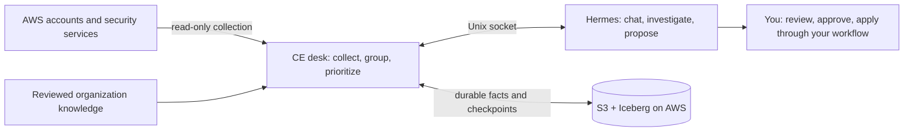

# RemediGenius Community Edition

Turn AWS security findings into a prioritized queue, evidence-backed investigations, and fixes you can review.

Tested with Hermes 0.23.1

Your AWS security services already find the problems. RemediGenius CE pulls their findings into one desk
on [Hermes](https://github.com/NousResearch/hermes-agent), ranks what matters, shows the evidence behind
each issue, and drafts fixes for you to review. It reads your account; it never changes it.

**[Get started](START-HERE.md)** · **[Prompt pack](docs/PROMPTS.md)** · **[Download v0.9.1](https://github.com/RajaRenga/RemediGenius-CE/releases/tag/v0.9.1)**

## The desk at a glance

A real scan of a live AWS account, on v0.9.1: the prioritized queue, the reason each issue scored the way
it did, and a coverage line that says what was and wasn't read. Account ids, ARNs and bucket names are redacted.

## See the triage board

The same desk, scrolling from the queue down to the coverage matrix. You drive it by asking questions in
chat, and the [prompt pack](docs/PROMPTS.md) is a good place to start. Identifiers are redacted.
[More stills and the coverage report](docs/TUTORIAL.md) ·
[v0.9.1 fresh-Spot validation](https://github.com/RajaRenga/RemediGenius-CE/releases/download/v0.9.1/VALIDATION.md)

## What you can ask it

| Start with | What the desk gives you |
| --- | --- |
| “What needs my attention?” | A P1–P4 queue of grouped issues, with written scoring reasons and the scan timestamp. |
| “Why is this issue P1? Show the evidence.” | Finding details and a bounded, read-only investigation that separates reported activity from configuration risk. |
| `/triage coverage` | The full account/region/source report, computed without a model call. Denied, disabled, partial and unavailable scopes stay visible. |
| “Propose a fix for this issue. Check for matching IaC first.” | A reviewed procedure, or a proposed IaC change when matching code exists. Verification stays pending until evidence supports it. |
| “Open a task for me to review.” | A human-owned Kanban card carrying the investigation, fix and verification context. With GitHub configured and your explicit authorization, CE can open a fix PR — it can't approve or merge it. |
| “Use our ownership and business-criticality rules.” | Priorities informed by reviewed organization knowledge, with citations. You maintain it in the Knowledge tab. |

These are starting points, not scripted answers. For exact coverage use `/triage coverage`; a chat briefing
may summarize the board's gap preview. And a quiet board, an expired session or a finding that disappears
is not proof an account is safe. [Response contract](docs/RESPONSE-CONTRACT.md)

## Run it in your environment

| Path | What you need | Start here |
| --- | --- | --- |
| Existing Hermes 0.23.1 | Your existing model configuration; CE adds a dedicated `remedigenius` profile | [Add CE to Hermes](docs/LOCAL-HERMES.md) |
| Docker workstation | Docker and a model provider; the pinned runtime runs alongside your current tools | [Run locally](docs/WORKSTATION.md) |
| AWS Spot | Your AWS account, a reviewed IAM setup, and a model provider | [Deploy in AWS](deploy/aws-single/README.md) |

However you run it, the first steps are the same:

1. **Connect read-only AWS access.** The [access quickstart](docs/ACCESS-QUICKSTART.md) prepares scoped roles
   for your account layout — single accounts, Organizations, cross-account readers and delegated administrators.
2. **Review the discovered scope.** CE separates readable accounts from findings-only access and unavailable
   readers. Pick your regions and look at the coverage gaps; discovery doesn't grant permissions.
3. **Run the first scan and ask what needs attention.** Investigate from the queue, review proposed fixes, and
   verify the outcome through your own change process.

Collection reads Security Hub (including exposure findings), GuardDuty, Inspector, IAM Access Analyzer, AWS
Config, CloudWatch alarms and AWS Health. What you get depends on the services, regions and permissions you've
enabled. [Multi-account guide](docs/MULTI-ACCOUNT.md) · [Permission flow](docs/PERMISSIONS.md)

## What's new in v0.9.1

- Hermes 0.23.1, pinned by immutable image digest. Existing-Hermes adoption checks the supported version.
- Held responses for critical reports: the guarded coverage and threat-fix paths return a deterministic report
  or a reviewed procedure, never an earlier model draft.
- Dashboard compatibility: the Board uses Hermes's authenticated, profile-aware API; the Knowledge and GitHub
  tabs were exercised in a real browser.
- Restore without rescanning: replacement compute brings back committed findings, grouped issues, coverage and
  the dashboard with the original observation time.
- PyArrow 23.0.1 with PyIceberg 0.12.0, plus reusable multi-account reader-role preparation and clearer install guides.

The release passed 59 host checks on fresh Linux/amd64 Spot, real Hermes response replays, authenticated browser
checks and the native streaming coverage API check, and the exact released artifacts were verified after upload.
[Final results and limits](https://github.com/RajaRenga/RemediGenius-CE/releases/download/v0.9.1/VALIDATION.md) ·
[Changelog](CHANGELOG.md) · [Upgrade guide](docs/UPGRADING.md)

## Your compute, your evidence

Compute and storage are separate. On AWS, S3/Iceberg keeps the evidence while Spot compute can be replaced or
parked, and you can browse committed scans as HTML and JSON in S3. Workstation installs use a local durable
folder. The dashboard and the exact coverage report read the same committed view.

Triage is read-only. In the containerized deployment, AWS credentials live in the desk service, outside Hermes,
behind scoped roles and runtime read guards. A native local Hermes install shares your user credential
environment and doesn't provide that container boundary. CE doesn't apply cloud remediation; fixes go through
your review and deployment process. [IAM boundaries](docs/IAM.md) · [Data and control flow](docs/DATA-FLOW.md)

You bring the AWS account and the model provider — one operator, one organization per installation. Selected
findings, identifiers, IaC excerpts, knowledge and chat can reach your configured model provider, and AWS and
model costs are yours. CE triages existing signals; it isn't a detector and doesn't guarantee complete coverage.
[What leaves your environment](docs/DATA-FLOW.md) · [Known limits](docs/LIMITS.md)

## Go deeper

[Architecture and interactive diagrams](docs/USER-ARCHITECTURE.md) · [Prompt pack](docs/PROMPTS.md) ·
[Customize CE](docs/CUSTOMIZATION.md) · [Knowledge sources & MCP](docs/KNOWLEDGE-SOURCES.md) ·
[GitHub integration](docs/GITHUB.md) · [Native Hermes API](docs/HERMES-API-OPTIONS.md) ·
[Recovery](docs/RECOVERY.md) · [Troubleshooting](docs/TROUBLESHOOTING.md) · [Contributing](CONTRIBUTING.md) ·
[Security](SECURITY.md)

Tried a prompt that worked — or one that didn't? Share it in
[Discussions](https://github.com/RajaRenga/RemediGenius-CE/discussions) or open a
[first-run friction issue](https://github.com/RajaRenga/RemediGenius-CE/issues/new/choose).

Apache-2.0, provided as-is. [License](LICENSE)