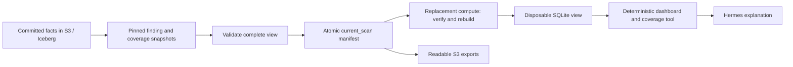

# Recovery and storage health

This runbook covers the v0.5.0 durable store. Facts live in S3 raw objects and Iceberg tables; the local SQLite cache
is rebuildable. The authority and commit rules are in [STORAGE.md](STORAGE.md), the table schemas in
[SCHEMA.md](SCHEMA.md).

## One active desk per storage namespace

Exactly one desk process may own a cache and commit loop for a namespace. The desk takes an OS file lock
(`desk.sqlite3.lock`) at startup; a second process fails with the owner PID instead of writing. Stop the old desk
before replacing an instance. There is no distributed leader election and no active-active mode.

## Complete committed view (post-v0.9.0)

Compute remains disposable. The `current_scan` Iceberg table is the atomic publication point for a complete
serving generation. It contains one versioned descriptor: original scan time, installation identity,
expected counts/content hash, finding order, coverage scope identities, exact grouping and scan metadata,
and references to existing finding/coverage table snapshots. It does not copy raw AWS responses or another
full set of finding payloads. Existing event and current-state tables remain in the same S3/Glue installation.

A scan commits its facts, updates current-state projections, verifies that the complete view can be rebuilt,
and publishes `current_scan` last. Failure before that final publication leaves the previous generation
addressable. Newer committed facts without a complete generation produce a degraded status, not a mixed view.
Readable exports are published afterward; their failure cannot invalidate the complete Iceberg generation.

## Normal restart or replacement Spot

1. Restore Hermes/configuration/knowledge checkpoints and open the configured Iceberg namespace.
2. Validate installation identity and schema; reconcile existing local outbox state when present.
3. Resolve `current_scan`. Read its pinned snapshots, reconstruct the complete scan, and verify membership,
   original observation time, counts and content hash. A missing reference or unsupported descriptor blocks recovery.
4. Overlay separately committed human decisions. Replace the local `latest_scan` view only after validation.
5. Regenerate local dashboard, reports and status from that view before opening the desk socket. Files are replaced
   atomically, with the status/hash marker written last. The health check detects a missing or mismatched dashboard.
6. Resume normal operation. A fresh AWS scan is a separate refresh, not a prerequisite for showing stored findings.

Recovery does not re-rank old findings using today's configuration or replace their observation time with a
commit/restart time. Zero findings is valid when accompanied by the committed coverage and scan metadata.
A missing complete view is never represented as an empty healthy account. Automatic scanning must be disabled
when testing this contract so that a new collection cannot hide a broken restore.

Existing-Hermes installations using the local CLI also rebuild missing stored views before `digest`, `board`,
`list`, `show` or `report`. Preserve `storage.installation_id` and the original catalog/warehouse configuration
when moving to a new machine. Recovery does not guess an installation identity from another namespace.
An uncommitted scan cannot replace the served dashboard: the CLI refuses publication until durability succeeds.

Legacy snapshots explicitly display unavailable comparison and fix metadata as unknown, rather than claiming
the restored view is a first scan or that no fixes were tracked. This limitation is also included in the
deterministic coverage report supplied to Hermes. A subsequent successful scan publishes complete metadata.
Legacy exports whose grouping references findings omitted by an older storage cap are also insufficient for
verified migration. Recovery blocks with a missing-finding explanation; an explicitly requested new scan is
needed to create a complete generation. This is not a claim that every historical installation can migrate
without collection.

## Existing installations without a manifest

A one-time compatibility path reads the existing export pointer and verifies manifest/file hashes,
installation, scan time, finding/issue counts, grouping references, full finding payloads against current
committed findings, and exact coverage against the export's pinned Iceberg snapshot. Only then is the
validated descriptor promoted into `current_scan`. No AWS collection is needed.

Old exports did not preserve original profile, change-history, fix or other scan metadata. Recovery labels
that limitation; it does not invent those fields. Findings, grouped issues, coverage and observation time
are preserved. An export older than committed scans, missing objects, inconsistent current facts or
unsupported formats block migration. Retain the previous running instance/checkpoint until upgrade proof
passes; do not erase evidence or trigger a scan merely to make a failed recovery appear successful.

## Three independent signals

- `view_readiness`: complete committed generation available, previous generation served with a warning, or blocked.
- `dashboard`: the generated board and status hash agree with the recovered view.
- `freshness`: age of the original AWS observation, independent of restoration time.

Storage being reachable is insufficient for `healthy`. A complete but old view is useful and explicitly stale;
a missing dashboard remains recovering. No new IAM grants or always-on database are introduced. The existing
scoped Glue table-management grant allows the additive `current_scan` table. Only one active writer per namespace
is supported. Built-in maintenance protects snapshots referenced by the serving generation; external expiration
or object deletion can still break recovery and must respect those references.

## MCP runtimes after replacement (next release)

Standard EC2 bootstrap restores the profile, supplies the Terraform-managed analytics role/workgroup,
and reinstalls pinned AWS MCP and Athena dependencies outside the checkpointed Hermes home.
Missing settings receive managed AWS MCP and enabled analytics defaults; explicit direct/disabled
operator choices survive. Runtime installation failure leaves collection running and affected reports
unavailable, never a successful empty result. Repair using the shipped
`deploy/aws-single/install-aws-investigation.sh` or `install-athena-runtime.sh` on the host, then retry.

Verify both a guarded AWS read and all four analytics reports after recovery, not just service health.
The November candidate passed this check after replacing the live lab instance; see
release validation. Query results are disposable in `analytics-results/`;
the Iceberg warehouse remains the evidence authority.

## S3 or Glue outage

- **During a scan:** raw pages wait in the bounded local buffer (`storage.buffer_limit_mb`, default 256 MB). The board
  and `doctor` show the backlog and `state: degraded`. At the limit, collection pauses rather than dropping evidence.
- **During a decision:** the decision is written to the local outbox and acknowledged as *saved locally, not yet
  durable*. It is retried; do not treat it as durable until the watermark advances.
- **During maintenance:** commits continue; maintenance reports the failure and leaves snapshots alone.
- **After recovery:** `rgtriage doctor` should show `state: healthy`, a recent commit watermark, an empty outbox and
  no buffered raw objects. `rgdesk maintain --dry-run` previews maintenance; `rgdesk maintain` runs it.

The only accepted loss window is data that never reached S3/Iceberg: an uncommitted scan (re-collected) and a decision
explicitly reported as not yet durable.

## GitHub operations across a restart

Every operation has a committed intent before GitHub is called and a result afterwards. On restart, intents without a
result are reconciled read-only across open, merged and closed pull requests using the original operation, branch and
proposal identity. A merged pull request is recorded as merged; recovery never creates an automatic `-r2` follow-up.
A replacement needs a new approved operation. `doctor` shows unresolved operations.

## Table maintenance

`rgdesk maintain` (or the desk's scheduled loop) compacts small files, expires snapshots while retaining
`min_snapshots` and `snapshot_retention_days`, and deletes only `.parquet` files that no remaining snapshot references
and that are older than `orphan_retention_hours`. It runs in-process; no Athena job or Spark cluster is required.
`--dry-run` reports what would happen.

## Validation evidence

`tests/test_storage_live.py` exercises the local profile on disk: committed scan and decision survive deleting the
cache; an uncommitted scan is reported for re-collection; a commit without acknowledgement is not duplicated;
maintenance during commits keeps rows; an unreachable store is `blocked`; health carries every contract field. The
optional AWS-profile run is skipped unless `RGTRIAGE_AWS_STORAGE_TEST=1` and a disposable Glue database and warehouse
are configured. A local-profile pass is not a claim about AWS durability or cost.

## Fresh-install detection

If the desk finds a v0.4 `latest.json` or `decisions.json` on a fresh cache, it stops with instructions to move or
delete the old desk state. It does not import it. Keep the v0.4 tag until you have exported what you need; see
[UPGRADING.md](UPGRADING.md).
