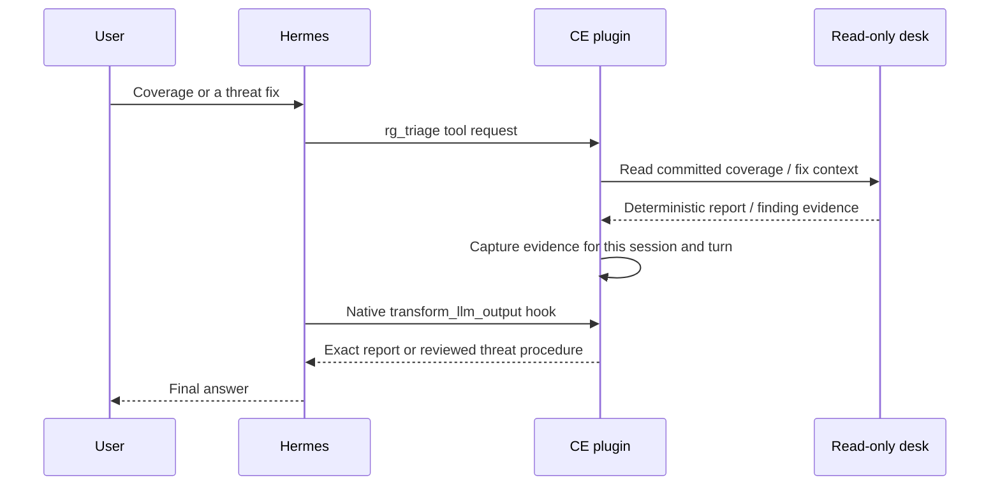

# Deterministic reports and reviewed threat procedures

CE keeps computation in the desk and conversation in Hermes. S3/Iceberg remains authoritative; no second
agent runtime or model service is introduced.

On `digest coverage=true`, the final answer contains the stored coverage report without model paraphrasing.
A mixed briefing can include the desk's board and grouped-issue output alongside it. Missing coverage produces
an unknown/pending response. `/triage coverage` remains the direct route without a model call.

On a threat `fix` request, the plugin reads the finding's structured category and identity from the desk.
The final answer identifies the stored finding, reports whether the fix context found matching IaC, and gives
a reviewed procedure. It separates long-lived keys, ordinary assumed roles and Identity Center sessions;
requires human review; distinguishes preventing new access from containing issued sessions; and leaves
verification pending until independent evidence establishes the intended state. It does not invent a custom
containment command. If the target cannot be read, it withholds the plan. `/triage fix REF` opens the full
desk context directly.

Posture/IaC diffs and investigations remain model-assisted. A threat procedure does not itself establish a
compromise verdict, an applied change, effective revocation, or incident closure. Investigate separately with
bounded evidence reads and the operator's incident process.

The hook's state is scoped to one session and turn and is not a new persistent data store. Final transformation
does no I/O; the evidence read occurs after the tool call. The pinned Hermes runtime transforms the answer
before persisting its final assistant message. CE pins Hermes 0.23.1 and registers this hook with
`hold_stream=True`: Hermes holds draft replies, suppresses interim commentary and retains the hook set
for the turn even if plugins reload. If no transform succeeds and one fails, Hermes withholds the reply.
The CE installer and EC2 profile synchronization also disable draft streaming and reasoning display
while preserving model settings. Tool progress is separate from the final-answer contract.

## Boundaries

- This protects the specified tool paths, not every possible free-form question or every model claim.
- The native hook must be supported and active. CE registers it as required; do not silently remove it to
  make an incompatible Hermes version load. Use the pinned runtime and the adoption preflight.
- Another output-transform plugin can take precedence. Keep this a dedicated profile; third-party hooks,
  custom clients and alternate worker modes need their own acceptance checks. Native held-output behavior
  does not certify every client or turn an unsupported model claim into verified evidence.
- The actual authorization boundary remains the credential-separated desk, its read guard and scoped AWS roles.
  An output transform is not an IAM control.
- Data collection scope comes from configured accounts, discovery and per-account regions; none of these
  responses assumes a fixed account count or a fixed region list.

See the acceptance gate, [fresh-start guidance](FRESH-START.md), and
[architecture](ARCHITECTURE.md).
