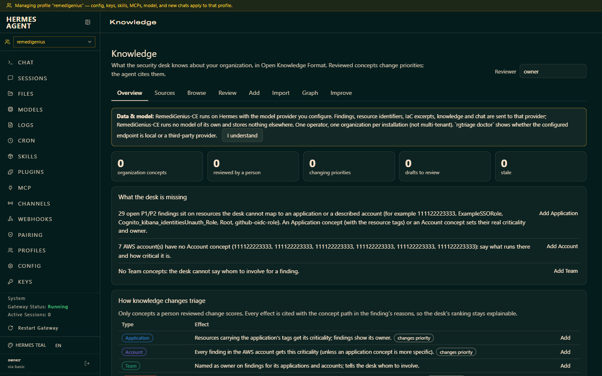
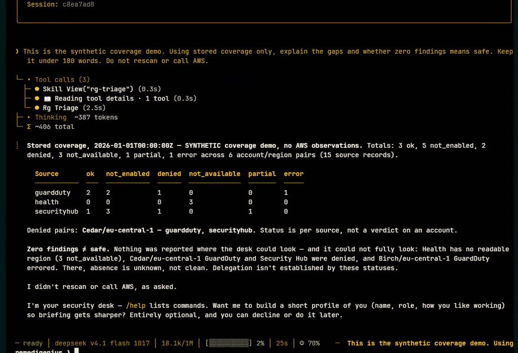

# The desk on a real account — v0.9.1

These captures were made on the **released v0.9.1** desk running on a live AWS account (Hermes 0.23.1,
pinned by image digest), after a real scan of the account's security services. **Account ids, ARNs, role
names and bucket names are redacted** to the documentation's example values. They show what the desk
produces; they are not a guarantee of complete coverage or of model reliability.

## The attention board


One scan becomes a prioritized queue. Each issue carries a written scoring reason (threat vs. posture,
business criticality, toxic combinations) and the observation time. The summary counts and the
"no change since the previous scan" line come from the committed snapshot, not a model guess.

## The whole board, including coverage


The coverage matrix is the part a quiet board can hide: for each account it shows which sources were
read, partial, denied or not enabled. **Absence of findings is not a clean bill of health.** The full
board is also available as a [single still](media/spot-v091/board-full.png).

For the exact, deterministic report — no model paraphrase — type `/triage coverage` in chat, or run
`rgtriage --durable digest --coverage`. It reads the committed snapshot; it does not scan AWS.

## Organization knowledge



The Knowledge tab holds what the desk knows about your organization — applications, accounts, teams,
ownership and accepted risks — in Open Knowledge Format. Reviewed concepts change priorities and the
agent cites them. *Overview → What the desk is missing* lists the gaps that matter (unowned P1/P2
resources, accounts without a description).

## Drive it in chat

The board is the result; you drive it by asking. Start with the [prompt pack](PROMPTS.md):
"What needs my attention?", "Why is this issue P1? Show the evidence.", "Propose a fix — check for
matching IaC first." Investigation is bounded and read-only; fixes are proposals you review and apply
through your own change process.

## What this does not prove

A successful screenshot is not live-AWS acceptance evidence for your account, and not a model-reliability
guarantee. Coverage depends on the services, regions and permissions you enable. The release's own
fresh-Spot validation record — including what was **not** tested — is
[VALIDATION.md](https://github.com/RajaRenga/RemediGenius-CE/releases/download/v0.9.1/VALIDATION.md).

---

## Reproducible synthetic demo (no AWS account, no model key)

The offline demo runs clearly synthetic findings through the real pipeline and writes the same board
page a real scan writes:

```bash
python tools/demo.py --html
```

Open the generated `demo-board.html`. A reproducible coverage fixture and seeder live in
[examples/coverage-demo](../examples/coverage-demo/README.md) for a separate demo installation. The
earlier condensed dashboard recording below used **synthetic** data on Hermes 0.21.7 (before this
release); it illustrates the interaction shape, not v0.9.1 acceptance.

[](media/hermes-triage/hermes-dashboard.mp4)

[Full synthetic recording (MP4)](media/hermes-triage/hermes-dashboard.mp4) ·
[Coverage response still](media/hermes-triage/coverage-response.png)