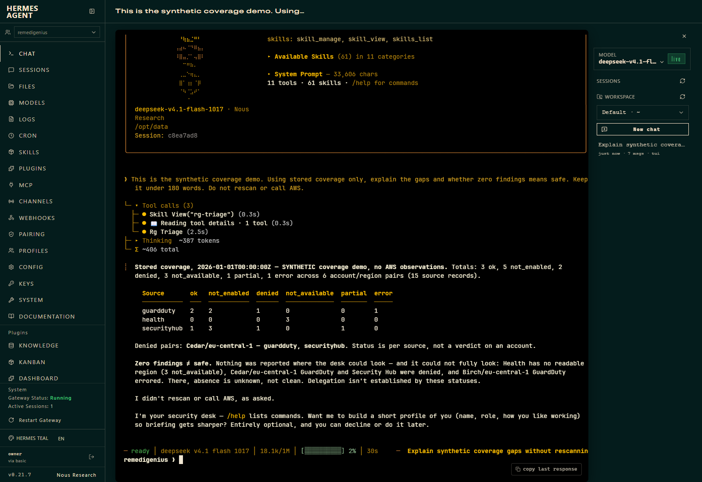

# Hermes dashboard: actual capture

The recording below was made on **Hermes 0.21.7**, before CE v0.9.1. The current release is tested with
**Hermes 0.23.1**; consult its [final validation record](https://github.com/RajaRenga/RemediGenius-CE/releases/download/v0.9.1/VALIDATION.md)
for current compatibility evidence. This clip demonstrates the interaction, not acceptance of the current release.
The GIF opens on the answer, then replays the interaction from the same recording: typing is accelerated 2×, waiting 5×, and the answer plays at its original speed.
It is cropped to the chat pane; the original full-frame MP4 remains available.

[Watch the actual dashboard recording](media/hermes-triage/hermes-dashboard.mp4)

This is a real browser screenshot and screen recording of the Hermes dashboard using the CE plugin,
a real configured model and a local durable desk.
The input is explicitly synthetic: fictional accounts, no customer findings and no AWS observations. Login
happens before recording. The recording includes typing, tool execution, waiting and the resulting answer;
there is no audio. No private account IDs, credentials or operational chat histories are used.

## Try the interaction

Use the [reproducible fixture and seeder](../examples/coverage-demo/README.md) in a separate demo installation.
The captured answer preserves all six statuses, identifies the denied pair and explains why zero findings do
not establish safety or delegated administration. Compare it to the fixture's expected counts.

For an exact report without model paraphrasing, type `/triage coverage`. It reads the committed snapshot;
it does not scan AWS or invoke the model. The CLI equivalent is `rgtriage --durable digest --coverage`.

## What this does not prove

This demo is not live AWS validation. Repeated conversational tests still exposed incorrect scope names and
summary prose despite correct table counts. Those failures remain an explicit acceptance gap.
Use the deterministic coverage report for exact scope decisions. A successful screenshot is not a model
reliability guarantee.
